# Конструктор модульных станков TIANQI

Попал мне в руки комплект модульных станков TIANQI. Несовместим ни с какими другими похожими конструкторами станков, и по всей видимости это сделано специально, что бы не тащили домой или не было смысла продавать, так как скорее всего это специальное изделие закупленное из китайского бюджета для китайских школ и не предназначается для продажи изначально. У него размеры основных балок (55х55), резьба на шпинделе м12 шаг 1.75мм, Т-паз, высота центров 27.5 - все нестандарт по сравнению с коммерческими станками. Конструктивно он более всего похож на так же довольно редкий ZHRUI, но так же не совместим с ним. Никаких данных о продаже модульных станков TIANQI найти не удалось. На официальном сайте производителя - ничего про то что такие станки им выпускались нет. Поэтому решил добавить информацию о такой редкой вещи для истории.

И таки он ко мне волей случая попал, комплект 7 в 1, в пластиковой версии (неизвестно есть ли какая либо другая) - балки алюминий, остальное пластик.
Комплектация привычная для такого набора: балка длинная, балка короткая, длинная подача (продольная), пару поперечных подач, 1 моторный блок, патрон токарный, задняя бабка, комплект цанг и гайка для фрезера, упор для резца по дереву и сам резец, шлифовальный диск, эксцентриковый механизм лобзика, тиски, проставки для повышения центра, блок питания, усилительные пластины и уголки, крепеж и мелочевка.

Фото самого комплекта в коробке и инструкцию прикладываю ниже:
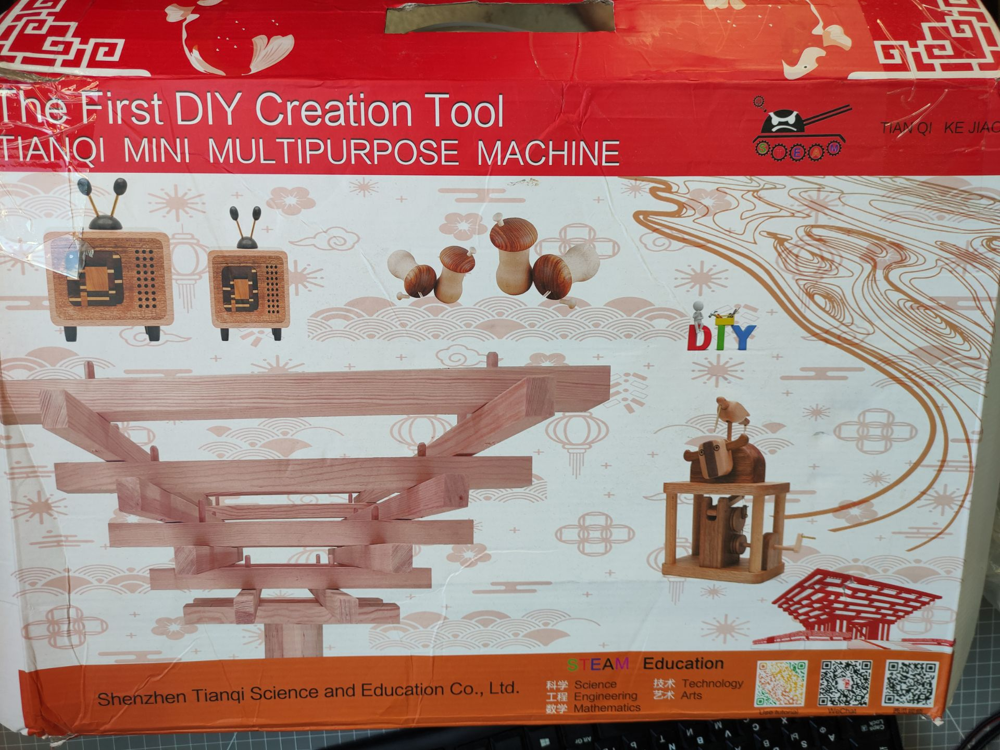
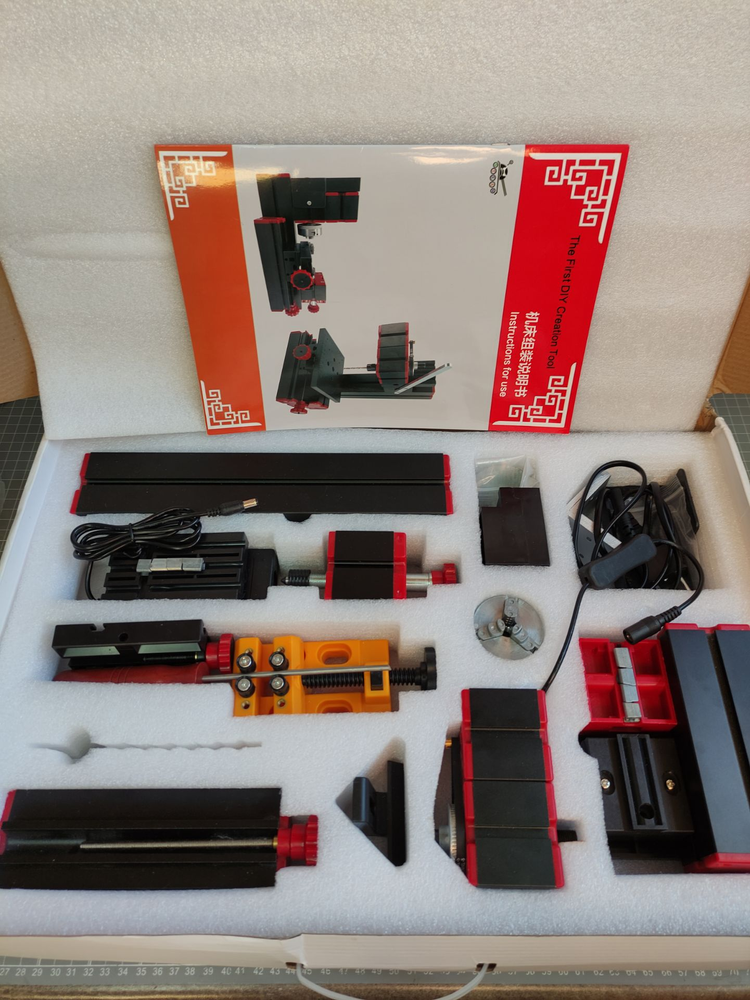
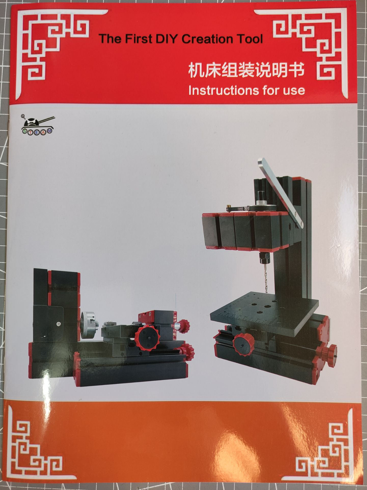
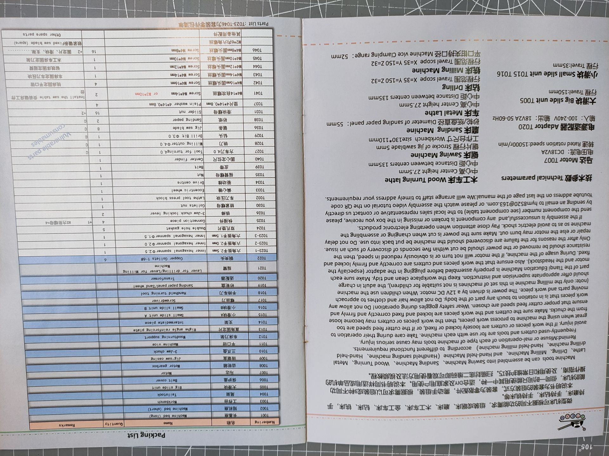
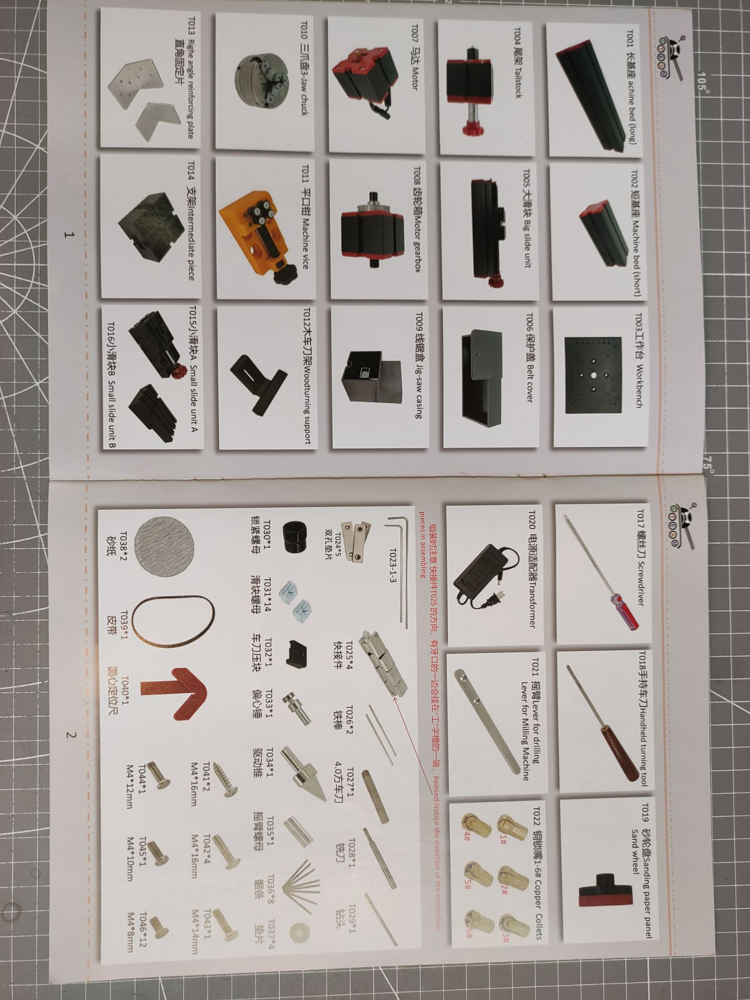
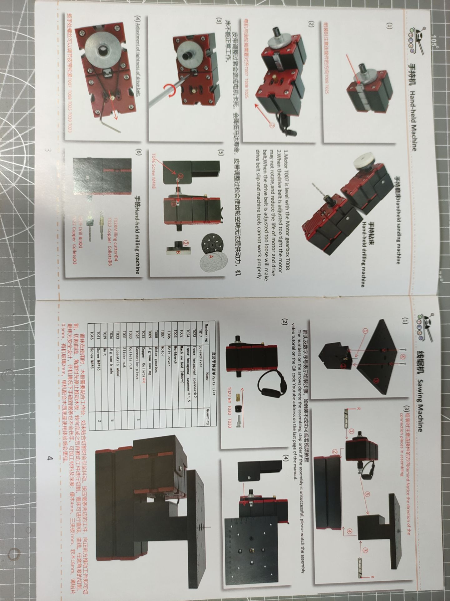
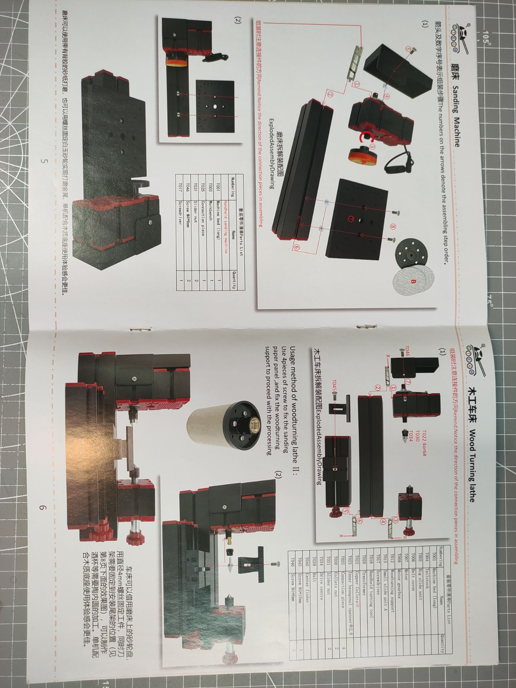
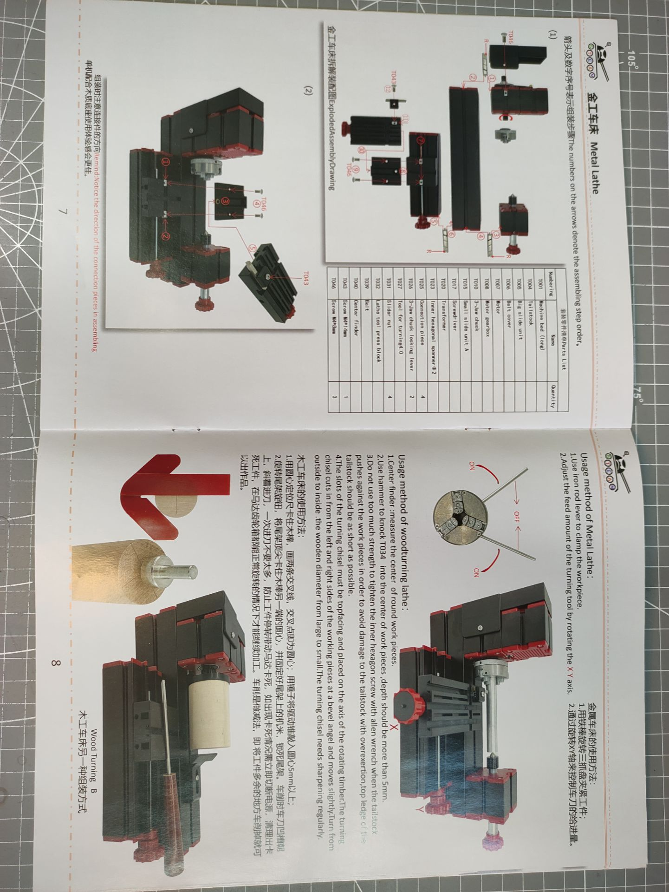
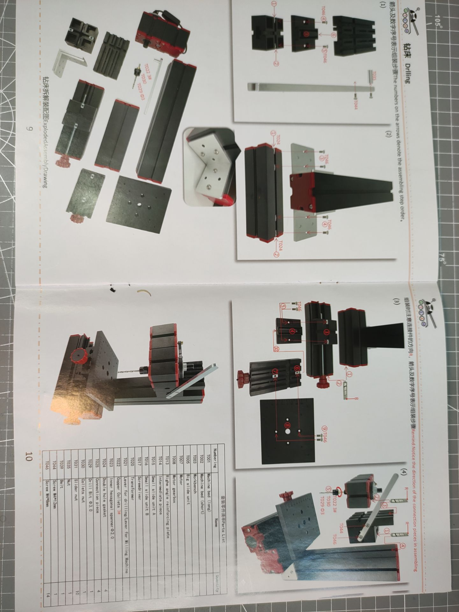
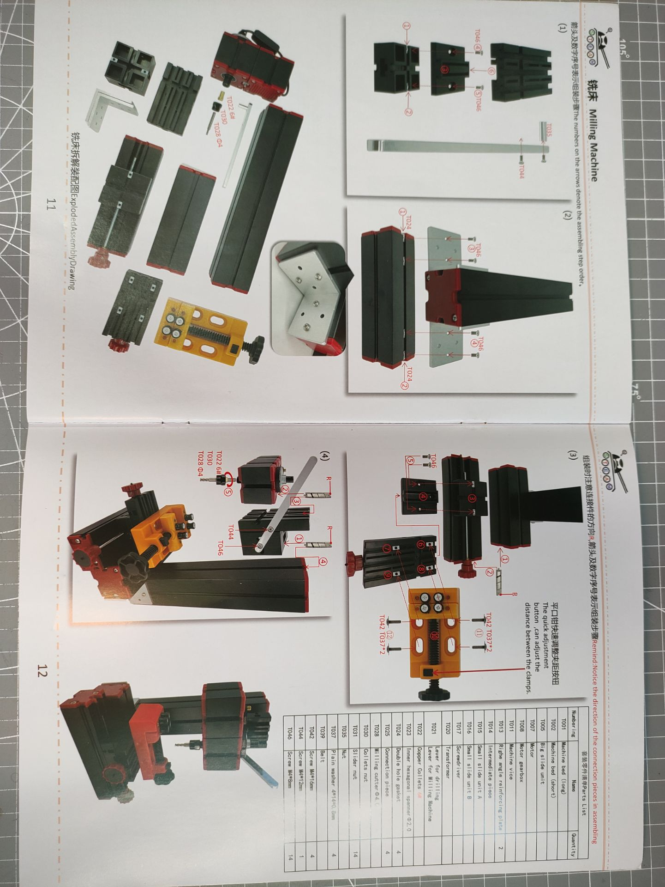
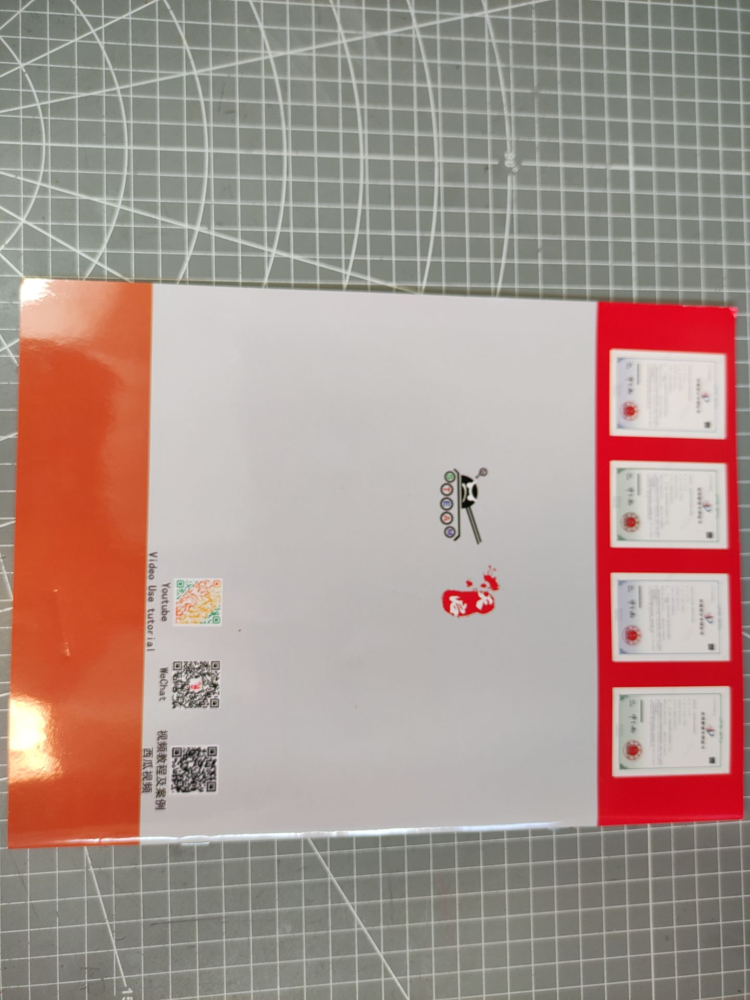

