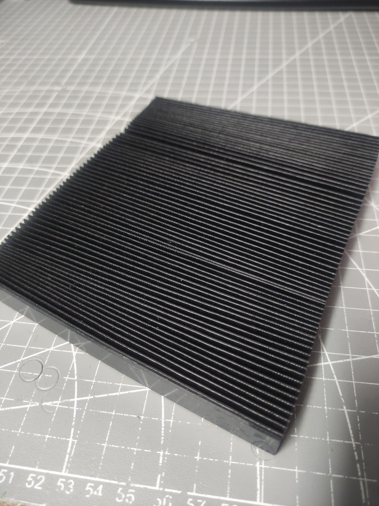
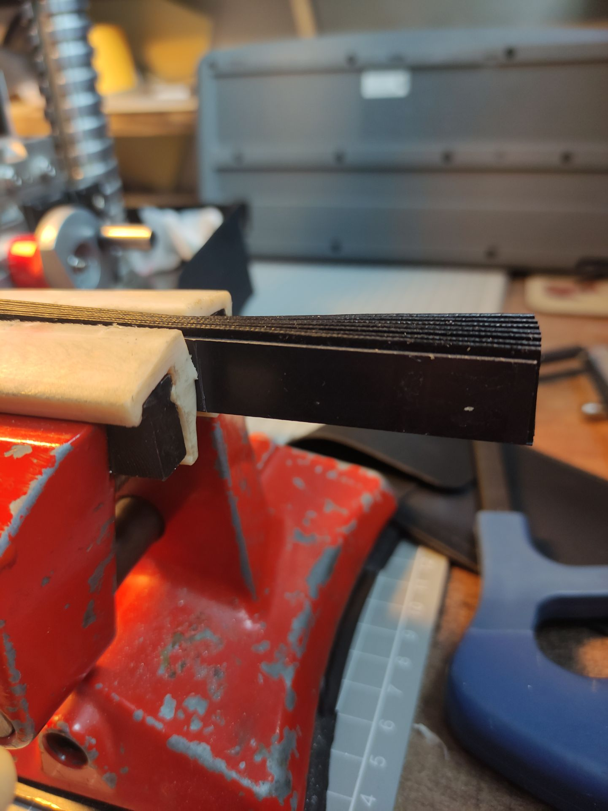
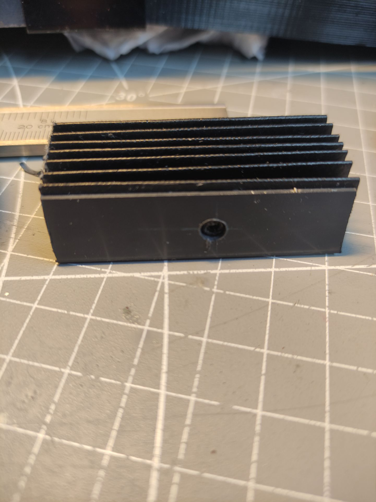
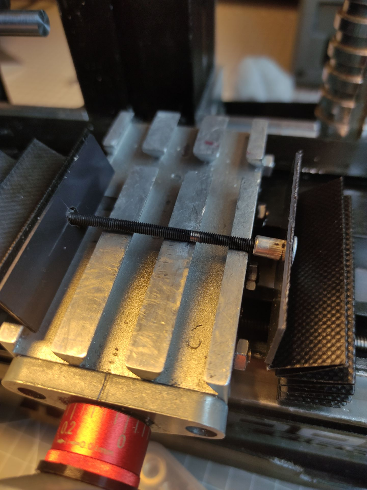
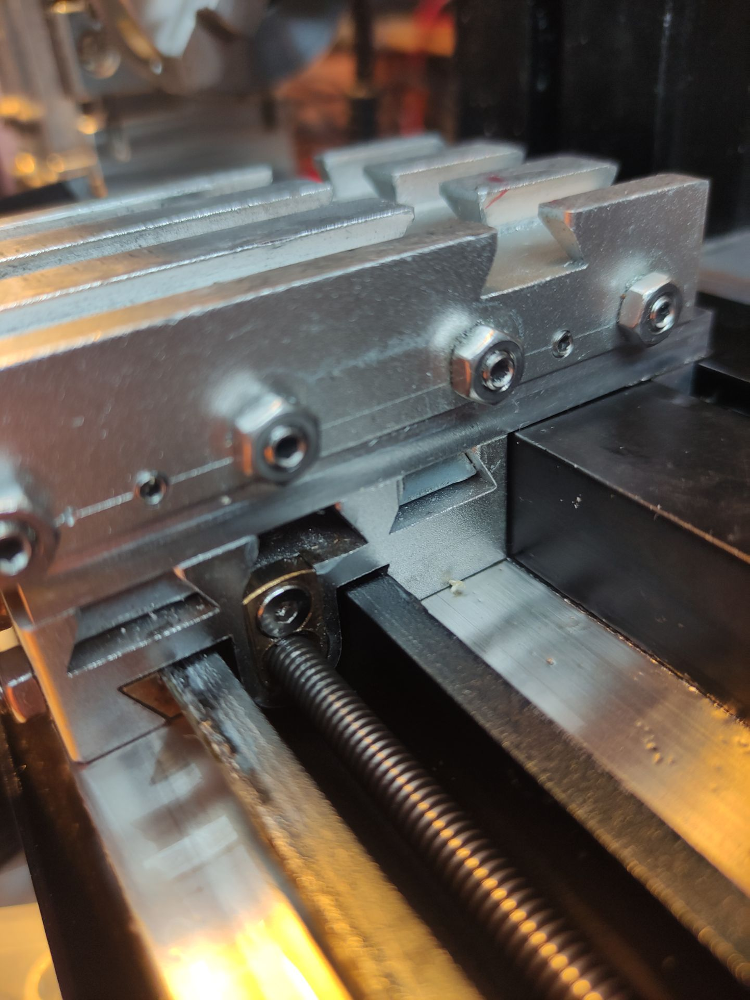
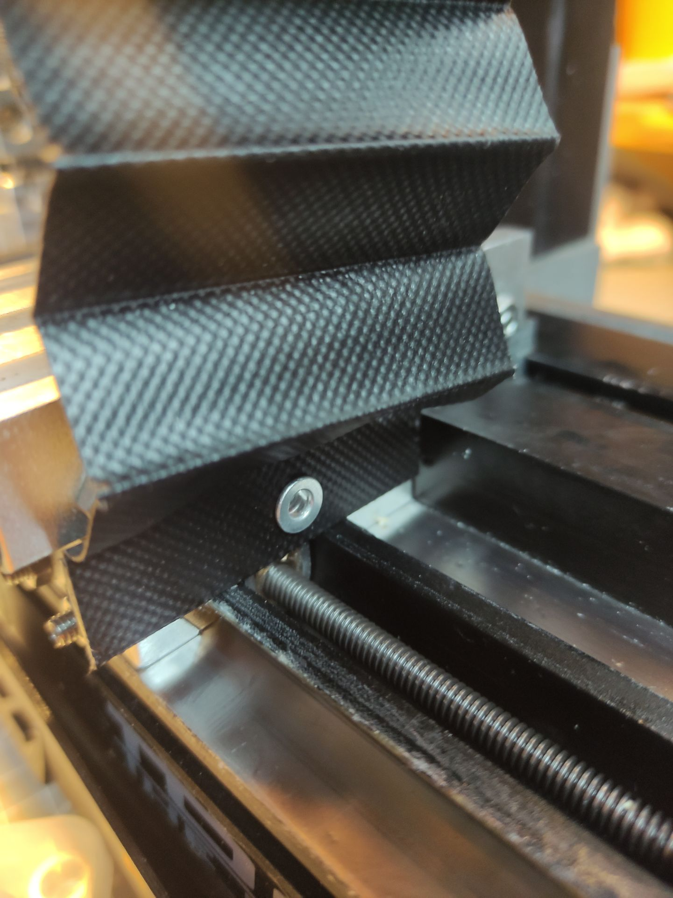
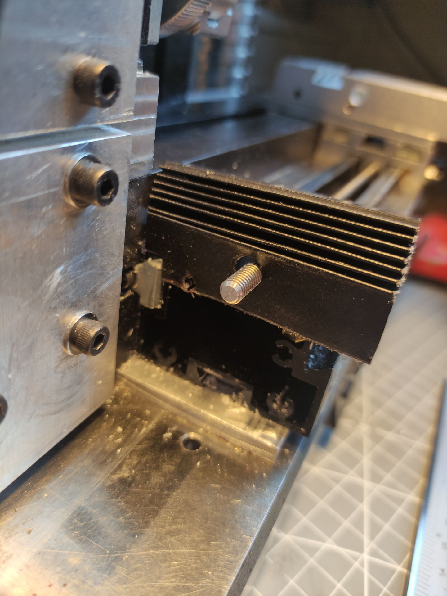
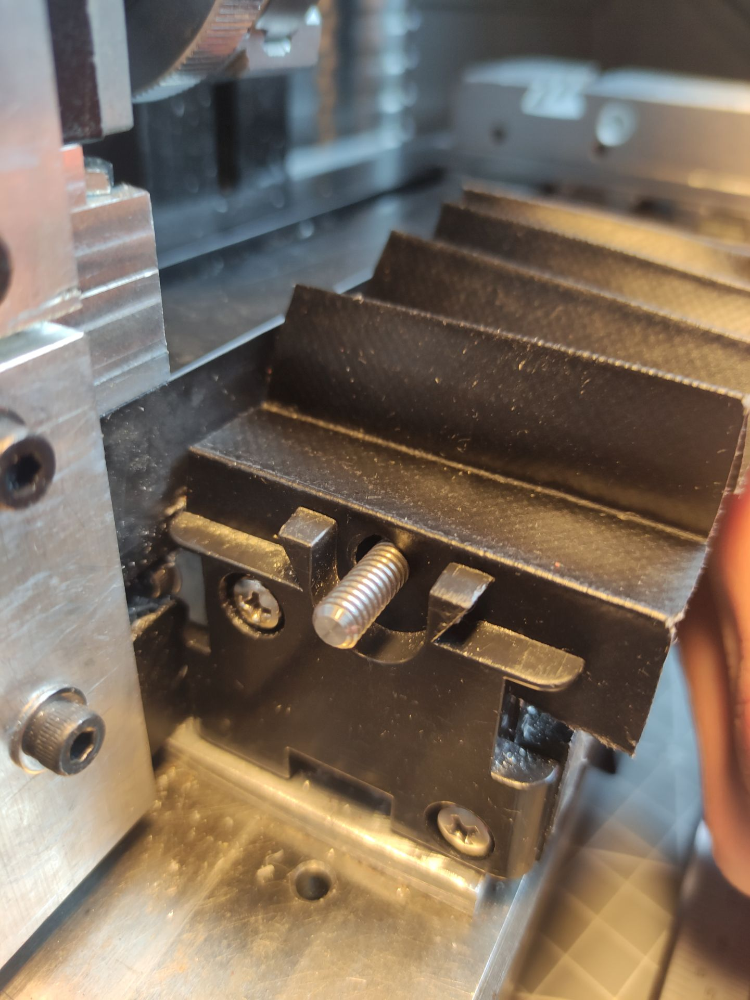
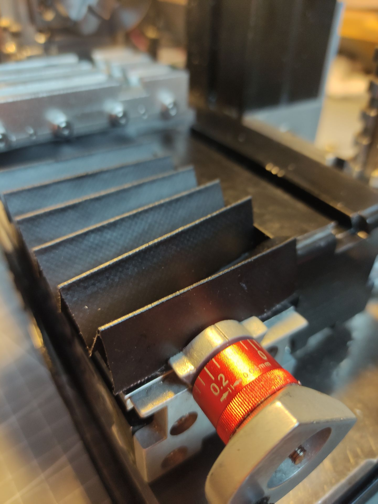
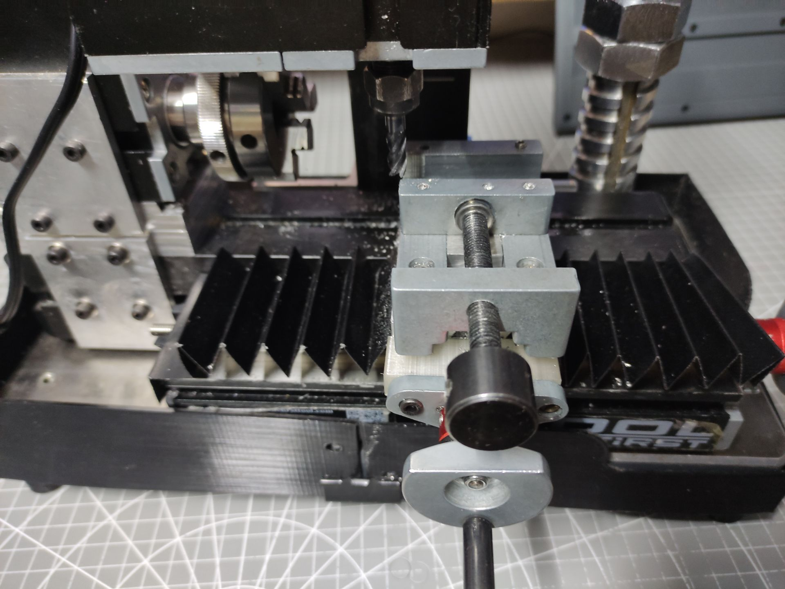

# Защита продольной подачи от стружки 

Постоянная головная боль - стружка на продольной направляющей, она налипает на винт вращения, забивается в пару винт-гайка, мелкую стружку затягивает под каретку подачи, в итоге ход подачи сильно затрудняется, становится рывками, может даже дойти до того что выдавит гайку из каретки или втулку скольжения из корпуса направляющей. Решил изготовить быстрый вариант защиты продольной подачи из куска гофрозащиты купленной в интернет-магазине. Продается "пылезащитный чехол направляющих" или "гофрозащита направляющих", стоит порядка 300-500 рублей, там большой выбор разных форм и размеров. Я купил вариант шириной 130мм, длиной 500мм, вот так он выглядит:

И так ножом под линейку отрезаю 7 складок гофры (отмерил длину просто по месту). Далее зажимаю в тиски и ножом отрезаю 2 куска шириной по 50мм.

Размечаю отверстие для крепежа и сверлю отверстие диаметром 5 мм. На другом конце гофры пробойником делаю отверстие под вал подачи (если у вас короткий штатный вал, то отверстие не нужно).

Закрепляю получившуюся гофру на каретку на винт М3 длинной 50мм, в качестве гайки использую резьбовую заклепку. Винт протягиваю через центральный паз верхней части каретки. Тут нужно учитывать что у меня центральный паз свободен, так как закрепление на моей нештатной каретке идет 4мя винтами, по бокам, а не тремя по центру.

Внешние стороны гофры креплю просто прижав штатными торцевыми крышками на направляющей подачи.

Успел опробовать данную гофрозащиту: хорошо работает, от стружки защищает, один минус - примерно по сантиметру справа и слева подачи получается мертвая зона где гофра максимально собирается и не дает далее двигаться каретке (надо разработать особые крышки направляющей что бы этого не происходило), но как бюджетный вариант на скорую руку - отличный.

